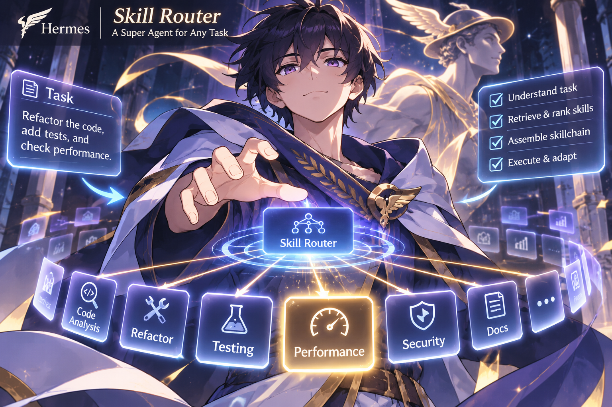

# hermes-skill-router

A Hermes Agent plugin that takes the always-on skill catalog out of every Chat Completions request and appends a short list of the skills that fit the turn.

The intent of this plugin is to provide a fundamental feature in everyday agentic use. In
particular, it is for people who keep one super-agent profile that does everything but do not want
the context polluted by so many skills that the model struggles to pick the right one. Even for
specialist profiles, the number of specific skills can grow quickly. A skill router for a
super-agent also pairs well with a memory provider like
[Hindsight](https://github.com/vectorize-io/hindsight), which takes care of memory routing and turns
raw history into organized memory that can be distilled into more skills when needed.

Our plugin combines three features: hiding the skill catalog, RRF first-pass combining semantic search, lexical search, and historical learning, and then the second pass reranking the shortlist with a decision model. The model keeps `skills_list`, `skill_view`, and `skill_router_search`, so it can still list, open, or search for any skill.

The skill list is embedded once and cached, so a warm turn does no catalog embedding: it pays for
the query embed and the rerank. The default 50-row shortlist reranked in a median 0.71 seconds on
8 CPU threads in our measurement.

This plugin does not replace periodic upkeep of your skill library, such as folding related skills
into references for a top-level skill. That upkeep is worth doing in plain Hermes too: clearer skills
help the model find the right one without any router. With this plugin it pays more, because the
router scores the name and the description when it picks a suggestion. Write the description in the
words you would use to ask for the task, and put the distinctive words first. The plugin picks from
the skill name plus the first 400 characters of the description, configurable with
`maxDescriptionChars`, so use that cap when you maintain the library.

Every setting, both endpoint protocols, the display record and the measurements are in
[technical-documentation.md](technical-documentation.md).



## How it works

Each turn, the plugin scores your skills against your latest message and adds the best matches to the request. Skills you pin as eager appear in that same block, under `Pinned skills:`.

Three signals build that list. Each one ranks the skills its own way.

Semantic search compares meaning. It embeds your newest message, plus the typed messages before it up to 10,000 characters, and ranks skill rows by how close their vectors are.

Lexical search compares exact words. It scores the same text against the catalog text the embedder sees, so a skill whose name or description uses your words ranks higher.

Associations remember what you actually loaded: if you opened a skill for a similar prompt before, that skill ranks higher here, and older loads matter less. If the association database is missing, this channel stays off and you get one warning. The other two channels still route.

The plugin merges the three rankings, giving lexical search half the weight of the other two, then cuts the result to a 50-row shortlist. `fusionMode: cosine` skips lexical search and associations, and returns the semantic order alone. `shadow` works out the merged order and logs it, but still returns semantic.

A reranker then looks at the shortlist. It scores each candidate against the same query. The plugin suggests the ones that score at or above `cutoff`, best first.

The reranker is `tasksource/tasksource-decider-nano`. It is a 150M-parameter reranker with 298 MB of weights. It runs on CPU, no GPU needed. On 8 CPU threads, the default 50-row shortlist reranked in a median 0.71 seconds over ten calls. Two calls took 4.5 and 5.2 seconds, while other jobs competed for the CPU; a 10-row shortlist took 0.15 seconds. That rerank score is what the plugin compares with `cutoff` and sorts by. It does not trust the merged order alone.

If a service is down or too slow, the plugin falls back to the ordinary skill catalog. It does that once per compaction window, so a bad endpoint costs latency, not a broken turn. The catalog never reaches the model twice in the same window.

### Historical learning (associations)

The association store fills itself from your history. The first routed turn that finds it missing or incomplete starts a background heal. The heal reads `~/.hermes/state.db` read-only and writes `~/.cache/hermes-skill-router/associations.db`. No manual step is needed, and the turn opens the store read-only. The heal is the only writer.

You can also fill it by hand. Run `python3 -m hermes_skill_router.associations --max-sessions 200`. That takes the same read-only boundary and is idempotent. Re-running it adds nothing.

## Install

1. Install the plugin.

   ```bash
   hermes plugins install <owner>/hermes-skill-router
   ```

   For development, link the checkout instead:

   ```bash
   ln -sfn /path/to/hermes-skill-router ~/.hermes/plugins/hermes-skill-router
   ```

2. Enable it.

   ```bash
   hermes plugins enable hermes-skill-router
   ```

3. Point the plugin at your own endpoints if you use them. The bundled defaults need no setting:

   ```yaml
   plugins:
     entries:
       hermes-skill-router:
         settings:
           embedBaseUrl: http://127.0.0.1:8012
           rerankBaseUrl: http://127.0.0.1:8010
   ```

4. Download and start both model servers. Run the setup script from the checkout root:

   ```bash
   python3 tools/setup_models.py
   ```

   It asks where to download the two model files, then downloads, pin-checks and starts the
   bundled embeddings server for BGE-M3 and the bundled decider rerank server for
   `tasksource-decider-nano`. On Linux it installs two systemd user units and prints the
   manage, start and stop commands; on macOS and Windows it starts both servers with
   `python3` and prints the same three commands. It never runs automatically, and it changes
   no plugin setting.

   The servers answer `POST /v1/embeddings` and `GET /health` on `127.0.0.1:8012`, and
   `POST /v1/rerank` and `GET /health` on `127.0.0.1:8010`. Both base URLs must be bare
   origins. [default-models.md](default-models.md) covers the two default models, how to
   download them by hand, and other ways to serve them.

5. Check both health routes, then run one turn and read its dump:

   ```bash
   curl -s 127.0.0.1:8012/health
   curl -s 127.0.0.1:8010/health
   HERMES_DUMP_REQUESTS=1 hermes -z "draft a git commit message for a bug fix"
   ```

   The newest dump under `~/.hermes/sessions/` carries no `## Skills` heading, and its last message
   starts with `Skills routed for this request`. When no block appears, the plugin log carries one
   warning naming the reason, or, for a completed pass that selected nothing, the decision line.

## Recommended setup

The defaults are what we run, and step 4 starts both servers on them, so a fresh install needs
no endpoint setting:

- Embeddings: BGE-M3 on CPU, served by the bundled `service.embed_server` on 8012, with
  `embedModelId: bge-m3`.
- Rerank: `tasksource-decider-nano` through the bundled `service.decider_rerank_server` on 8010,
  with `rerankProvider: cohere`.
- Routing: `cutoff: 0.01`, `shortlistSize: 50`, `maxSuggestions: 10`, `fusionMode: live` with all
  three channels on, and the 6000, 20000 and 30000 ms timeouts. Keep them unless your endpoints need
  different budgets.

## Use

A routed turn adds one system message. Suggestions come first, then pinned skills:

```
Suggestions:
- <suggested name>: <description>
  path: <absolute path to the skill's SKILL.md>
- <suggested name with no description>
  path: <absolute path>

Pinned skills:
- <eager name>: <description>
  path: <absolute path>
```

Each row gives the skill's name, its description, and the path `skill_view` opens. Suggestions are
best first, capped at `maxSuggestions` (`0` means no cap). Pinned skills appear only in the first block of a conversation, or again after compaction
removes an earlier block.

Skills you keep listed with `deferredSkills` appear under `Also listed:`. If you do not set
`deferredSkills`, that section never appears.

The model can open any row with `skill_view`. `skills_list` still lists the whole catalog. If the
shortlist misses, the model can search by hand with `skill_router_search`, using its own words.

You also see the last decision on screen, at no token cost. In the desktop app or webapp, press
Ctrl+K, select hermes skill router, and enable the Desktop option in the Skills routed config
window. The `Skills routed` pane then appears on the right sidebar, collapsed by default. In
`hermes --tui`, run `/skills-routed` to dock the same names. The record holds names only, never
your request text.

## Configuration

Settings live under `plugins.entries.hermes-skill-router.settings` in the profile config. These are
the ones most setups touch:

| Option | Default | Meaning |
| --- | --- | --- |
| `enabled` | `true` | Master switch. False leaves every request untouched. |
| `embedBaseUrl` | `http://127.0.0.1:8012` | Embeddings endpoint root. |
| `embedModelId` | `bge-m3` | Model name sent to the embeddings endpoint. |
| `rerankBaseUrl` | `http://127.0.0.1:8010` | Rerank endpoint root. |
| `rerankModel` | `tasksource-decider-nano` | Model name sent to the rerank endpoint. |
| `eagerSkills` | empty | Skills listed under `Pinned skills:` in the router block, with their read paths, and never suggested. |
| `maxSuggestions` | `10` | Cap on suggested rows, from 0 to 50. `0` means unlimited. |

Every other key, with its bound and its effect, is in the
[configuration reference](technical-documentation.md#configuration).

## Analytics

[tools/analytics_scores.py](tools/analytics_scores.py) is a read-only score-drift check.
It recomputes the search score for every catalog skill and replays the historical
association score as of each logged decision, then flags every skill whose
history-minus-search divergence reaches 0.4 and prints its top-5 diverging prompts,
or `no anomalies`. Run it from the checkout root with the logged run's values:

```bash
python3 tools/analytics_scores.py \
  --store <copy of associations.db> \
  --log <plugin log with decision lines> \
  --catalog <saved-index JSON copy> \
  --embed-url <embeddings endpoint URL> \
  --max-description-chars <the logged run's value> \
  --state-db <Hermes session store> \
  --assert-complete-source-history
```

`--embed-model` and `--embed-timeout-ms` are optional. When omitted, each defaults to
the workspace config's `embedModelId` and `embedTimeoutMs`, then to the built-in
default where no custom config exists. The script opens the store and the session
store read-only and never writes either.

## Documentation

- [technical-documentation.md](technical-documentation.md) covers routing end to end, the request
  rewrite, the suggestion record schema, both display protocols, every setting, both endpoint
  protocols, failure behaviour, the measured effect and the tests.
- [after-install.md](after-install.md) is the short note shown after `hermes plugins install`: the
  setup command, what it downloads and starts, and the route for custom endpoints.
- [default-models.md](default-models.md) covers the default embedder and reranker models, how to
  download them, how to serve each one, how to check the endpoints answer, and what the plugin does
  when an endpoint is down.
- [LICENSE](LICENSE) is the MIT license.
