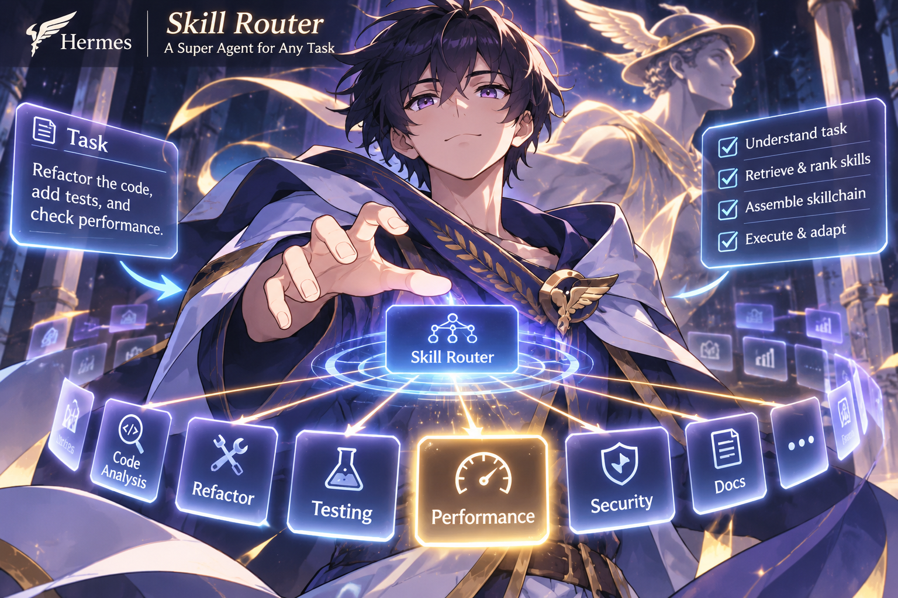

# hermes-skill-router

A Hermes Agent plugin that takes the always-on skill catalog out of every Chat Completions request
and appends a short list of the skills that fit the turn. The model keeps `skills_list` and
`skill_view`, so it can still list or open any skill.

The skill list is embedded once and cached, so a warm turn does no catalog embedding: it pays for
the query embed and the rerank. The default 50-row shortlist reranked in a median 0.71 seconds on
8 CPU threads in our measurement.

The intent of this plugin is to provide a fundamental feature in everyday agentic use. In
particular, it is for people who keep one super-agent profile that does everything but do not want
the context polluted by so many skills that the model struggles to pick the right one. Even for
specialist profiles, the number of specific skills can grow quickly. A skill router for a
super-agent also pairs well with a memory provider like
[Hindsight](https://github.com/vectorize-io/hindsight), which takes care of memory routing and turns
raw history into organized memory that can be distilled into more skills when needed.

This plugin does not replace periodic upkeep of your skill library, such as folding related skills
into references for a top-level skill. That upkeep is worth doing in plain Hermes too: clearer skills
help the model find the right one without any router. With this plugin it pays more, because the
router scores the name and the description when it picks a suggestion. Write the description in the
words you would use to ask for the task, and put the distinctive words first. The plugin picks from
the skill name plus the first 400 characters of the description, configurable with
`maxDescriptionChars`, so use that cap when you maintain the library.

Every setting, both endpoint protocols, the display record and the measurements are in
[technical-documentation.md](technical-documentation.md).



## How it works

Hermes dumps the whole skill catalog into the model context. This plugin hides the catalog and only
surfaces skill suggestions when they fit the task. You can also pin a list of eager skills that
appears under `Pinned skills:` in the router block.

The embeddings endpoint compares your newest message, together with the typed
messages before it (up to 10,000 characters), with the skill rows and keeps a cosine order. A BM25
term index built beside the vector index scores the same text by the prompt's exact words, and a
read-only association store adds skills that were loaded for similar prompts before. The plugin
fuses those three orders with reciprocal rank fusion, gives candidates a small capped recency bump
when their skill path resolves, and cuts the result to the shortlist. The rerank endpoint then
scores that shortlist against the same query, and the plugin suggests what scores at or above
`cutoff`.

The rerank stage runs on `tasksource/tasksource-decider-nano`, a 150M-parameter cross-encoder with
298 MB of weights that runs on the CPU and needs no GPU. On our machine, with 8 CPU threads, the
default 50-row shortlist reranked in a median 0.71 seconds over ten calls, with the two slowest calls
at 4.5 and 5.2 seconds while other jobs competed for the CPU; a 10-row shortlist took 0.15 seconds.
That is the rerank share of a routed turn's cost, and it buys a relevance score per candidate that
the plugin compares with `cutoff` and sorts by, instead of trusting the fusion order alone.

If a service is down or too slow, the plugin falls back to the ordinary skill catalog once per
compaction window, so a bad endpoint costs latency, not a broken turn, and the catalog never
reaches the model twice in the same window.

### Historical learning (associations)

The router learns which skills you loaded for similar prompts. The association channel decays
each load with a 30-day half-life and surfaces skills with support of three or more for the
current prompt's terms. A separate recency bump counts a skill once per session turn and fades
it with a 14-day half-life, moving it up at most five shortlist positions. A missing database
means the channel is off with one warning and the other two channels still route.

To seed it from your history, let one routed turn write the index at `cachePath`, then run:

```bash
python3 -m hermes_skill_router.associations --catalog ~/.cache/hermes-skill-router/index.json
```

That reads `~/.hermes/state.db` read-only and writes
`~/.cache/hermes-skill-router/associations.db`. The `--catalog` file is the index at `cachePath`,
which defaults to `~/.cache/hermes-skill-router/index.json`; pass your configured path when you
changed it. The command exits 1 with `cannot read catalog` when that file is absent. Add
`--max-sessions N` for a bounded scan. The command is idempotent, so re-running it adds nothing.
The backfill is the only writer: a routed turn opens the store read-only, so rerun the command
after a batch of work whose loads you want the channel to learn from.

### Pre-reranking

Three channels propose a fused shortlist (size 50), then the reranker scores it:

- Cosine: the newest message plus up to 10,000 characters of preceding context, embedded
  and compared by vector similarity.
- BM25: the same query text scored by exact words (`k1 1.2`, `b 0.75`) over the catalog
  text the embedder sees.
- Associations: skills with decayed usage for the prompt's terms, as above.

Reciprocal rank fusion (constant 20, weights 1.0, 0.5, 1.0) merges the three orders, a
recency bump moves a skill up at most 5 positions, then the cut to 50 happens. Only then
does the reranker run. `fusionMode: cosine` skips the term index, the store, and the bump
and returns the cosine order alone; `shadow` computes the fused order and logs it while
still returning cosine.

## Install

1. Install the plugin.

   ```bash
   hermes plugins install <owner>/hermes-skill-router
   ```

   For development, link the checkout instead:

   ```bash
   ln -sfn /path/to/hermes-skill-router ~/.hermes/plugins/hermes-skill-router
   ```

2. Enable it.

   ```bash
   hermes plugins enable hermes-skill-router
   ```

3. Point the plugin at an embedder and a reranker in the profile config:

   ```yaml
   plugins:
     entries:
       hermes-skill-router:
         settings:
           embedBaseUrl: http://127.0.0.1:8012
           rerankBaseUrl: http://127.0.0.1:8010
   ```

4. Run both services. This repository ships an embeddings server for BGE-M3 on CPU:

   ```bash
   HSR_MODEL_DIR=/path/to/bge-m3 HSR_PORT=8012 python3 -m service.embed_server
   ```

   It serves `POST /v1/embeddings` and `GET /health` on `127.0.0.1:8012`. No reranker is bundled, so
   point `rerankBaseUrl` at any service that answers the rerank protocol in the technical
   documentation. Both base URLs must be bare origins.
   [default-models.md](default-models.md) covers the two default models, how to download them, and
   three ways to serve the embedder and the reranker.

5. Check both health routes, then run one turn and read its dump:

   ```bash
   curl -s 127.0.0.1:8012/health
   curl -s 127.0.0.1:8010/health
   HERMES_DUMP_REQUESTS=1 hermes -z "draft a git commit message for a bug fix"
   ```

   The newest dump under `~/.hermes/sessions/` carries no `## Skills` heading, and its last message
   starts with `Skills routed for this request`. When no block appears, the plugin log carries one
   warning naming the reason, or, for a completed pass that selected nothing, the decision line.

## Recommended setup

The defaults are what we run, so you only have to set the two base URLs:

- Embeddings: BGE-M3 on CPU, served by the bundled `service.embed_server` on 8012, with
  `embedModelId: bge-m3`.
- Rerank: `tasksource-decider-nano` through a Cohere-compatible rerank service on 8010, with
  `rerankProvider: cohere`.
- Routing: `cutoff: 0.01`, `shortlistSize: 50`, `maxSuggestions: 10`, `fusionMode: live` with all
  three channels on, and the 6000, 20000 and 30000 ms timeouts. Keep them unless your endpoints need
  different budgets.

## Use

A routed turn ends with one extra system message. The sample below carries suggestion rows first,
then the pinned rows:

```
Suggestions:
- <suggested name>: <description>
  path: <absolute path to the skill's SKILL.md>
- <suggested name with no description>
  path: <absolute path>

Pinned skills:
- <eager name>: <description>
  path: <absolute path>
```

Every suggestion and pinned row carries its name, its description and the path the host's skill lookup
resolved, which is the file `skill_view` opens. Suggestions are best first, capped at
`maxSuggestions`, where `0` means no cap. Pinned rows appear in the opening block, the block of a
request whose messages carry no earlier router block; a request whose messages carry an earlier block
carries the suggestions only, and a request whose earlier block a compaction removed is the opening
block again and lists the pinned rows. Rows that `deferredSkills` leaves listed stay under an `Also
listed:` marker on every turn and are never suggested. The model can open any row with `skill_view`,
and `skills_list` still lists the whole catalog. When the shortlist misses, it can search by hand:
`skill_router_search` takes any `query` in the model's own words and returns ranked names,
descriptions and skill paths.

The last decision also appears on screen, and neither place costs a token. The desktop app gets a
`Skills routed` pane on the right rail, collapsed by default, with the names and one caption line. In
`hermes --tui`, run `/skills-routed` to dock the widget, which reads the same record and shows the
same names. Both show their caption only for a routed record. The record holds names only and never
request text.

## Configuration

Settings live under `plugins.entries.hermes-skill-router.settings` in the profile config. These are
the ones most setups touch:

| Option | Default | Meaning |
| --- | --- | --- |
| `enabled` | `true` | Master switch. False leaves every request untouched. |
| `embedBaseUrl` | `http://127.0.0.1:8012` | Embeddings endpoint root. |
| `embedModelId` | `bge-m3` | Model name sent to the embeddings endpoint. |
| `rerankBaseUrl` | `http://127.0.0.1:8010` | Rerank endpoint root. |
| `rerankModel` | `tasksource-decider-nano` | Model name sent to the rerank endpoint. |
| `eagerSkills` | empty | Skills listed under `Pinned skills:` in the router block, with their read paths, and never suggested. |
| `maxSuggestions` | `10` | Cap on suggested rows, from 0 to 50. `0` means unlimited. |

Every other key, with its bound and its effect, is in the
[configuration reference](technical-documentation.md#configuration).

## Documentation

- [technical-documentation.md](technical-documentation.md) covers routing end to end, the request
  rewrite, the suggestion record schema, both display protocols, every setting, both endpoint
  protocols, failure behaviour, the measured effect and the tests.
- [default-models.md](default-models.md) covers the default embedder and reranker models, how to
  download them, how to serve each one, how to check the endpoints answer, and what the plugin does
  when an endpoint is down.
- [LICENSE](LICENSE) is the MIT license.
